# hankel-pill

There is one simple idea that turns up, under a different name, in logic, engineering, physics,
statistics, computer science, pure mathematics, neuroscience and machine learning. Once you see it,
you keep seeing it. This page is the version I'd send you after getting you excited about it in
conversation.

- **New to all of this?** Read this page. It has no formulas.
- **Want to actually learn it?** Point an AI tutor at [`SYLLABUS.md`](SYLLABUS.md). It is a list of
  big ideas in a sensible order, written for an LLM to teach from, at whatever depth you like.
- **Want the precise statements and references?** See [`docs/field-guide.md`](docs/field-guide.md).

---

## The idea

**1. Make a table of pasts and futures.** Take any system that unfolds over time: a machine reading
input, a language, a planet, a market, a neural network. Make a big table. Each row is a possible
**past** (what has happened so far). Each column is a possible **future** (what could happen next). Each
entry records what happens when that past is followed by that future: yes or no, a probability, a
measurement. Mathematicians call this a **Hankel matrix**; below it's written H[p, f], for
past p and future f.

**2. The state is whatever makes rows different.** If two pasts have identical rows, they lead to
exactly the same futures, so nothing distinguishes them that will ever matter. They are the same
**state**. So the number of genuinely different rows is the number of states the system needs, and
the state of a system *is* "what you need to remember about the past to predict the future". You
can work this out from behaviour alone, without opening the box.

**3. With numbers, "different rows" becomes "independent rows".** When the entries are numbers,
some rows are blends of others and add nothing new. The number of independent rows (the **rank**
of the table) is the size of the smallest machine that reproduces the behaviour. And there is a
standard procedure from linear algebra that builds that machine from the table.

**4. Rank things by importance and keep the top few.** Real tables are noisy and huge, so in
practice nothing is exactly finite. A second standard tool, the **singular value decomposition**
(SVD), breaks the table into ingredients sorted from most to least important. Keep the top *r* and
you get the best *r*-dimensional summary of the past *for predicting the future*, plus a receipt:
a guarantee of how much you lost by dropping the rest.

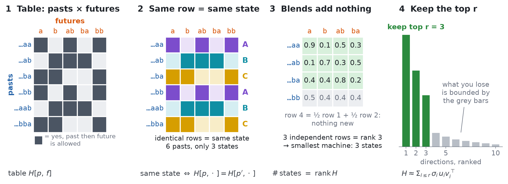
*The whole idea in four steps: a table of pasts by futures; identical rows are the same state; rows that are blends of others add nothing (rank); keeping the most important directions loses only what the grey bars measure.*

That's it. **Table of pasts by futures → its rows are states → keep the important directions,
with a guarantee.** The rest of this page is the same steps in different clothes.

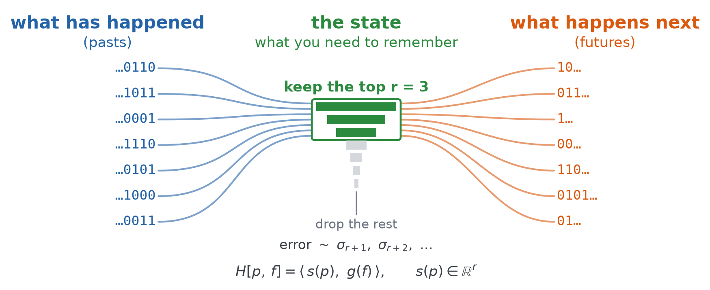
*Many pasts funnel through a small state, the few things worth remembering, ranked by importance, and fan out to futures. Dropping the faint bars has a guaranteed cost.*

---

## The same idea under different names

Each entry: what the field calls it, what it studies, and what the table, the states and the
"keep the important part" step turn into there.

**Logic and automata: the Myhill–Nerode theorem.** Studies which languages a finite machine can
recognize. The table says which endings complete which beginnings into a valid word. Distinct rows
are exactly the states of the smallest possible machine; a language is recognizable by a finite
machine exactly when there are finitely many distinct rows. Replace "yes/no" with numbers and you
get **weighted automata**, where the number of states is the rank of the table (**Fliess's theorem**).
Surprisingly simple questions about these machines are still open: whether a sequence defined by a
linear recurrence ever hits zero (the **Skolem problem**) is not known to be decidable.

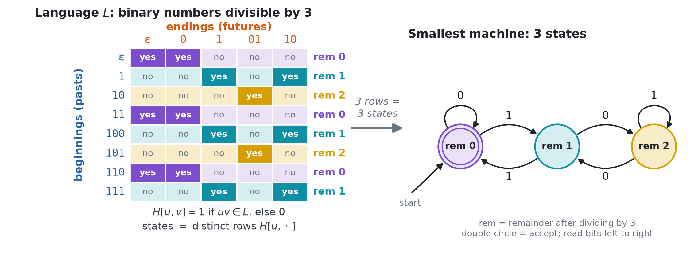
*For "binary numbers divisible by 3", the table of beginnings by endings has only three different rows, and those are exactly the three states of the smallest machine (remainder 0, 1, 2).*

**Machine learning theory: learning automata from questions.** Studies how to learn a hidden
machine by experimenting with it. **Angluin's L\*** algorithm learns a finite machine by filling in a
small corner of the table, asking "is this string accepted?". **Spectral learning** does the same
with statistics from data instead of questions and an SVD instead of exact bookkeeping. It learns
hidden Markov models without getting stuck in bad local optima, as iterative training can.

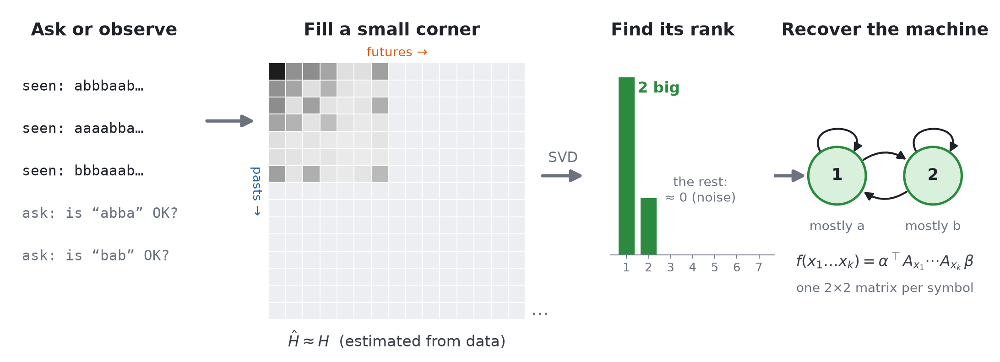
*A learner fills a small corner of the infinite table from data or questions; the SVD shows two big directions, which recovers a 2-state hidden machine.*

**Category theory: minimal realization as a factorization.** The table is a map from pasts to
futures. Any machine factors that map as "past → state → future", and the minimal machine is the
smallest thing that fits in the middle. **Reachable** states (the past side) and **observable**
differences (the future side) are mirror images, the **algebra/coalgebra duality**, and this is why
**Brzozowski's** odd-looking "reverse it twice" minimization algorithm works.

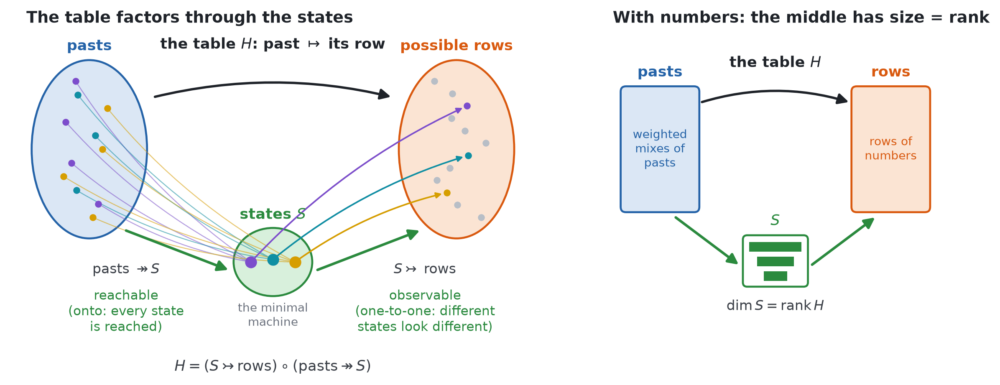
*The table factors as pasts → states → rows: every state is reached (onto), and different states behave differently (one-to-one). With numbers, the middle has size equal to the rank.*

**Control theory: realization theory and model reduction.** Studies how to rebuild the inside of a
black box (an aircraft wing, a circuit) from input–output measurements, then simplify it. The table
maps past inputs to future outputs; its rank is the size of the smallest internal state that
explains it (the **Ho–Kalman theorem**). **Balanced truncation** ranks internal states by how easy they
are both to push and to see, discards the weak ones, and guarantees the simplified model is
close. Engineers use this every day.

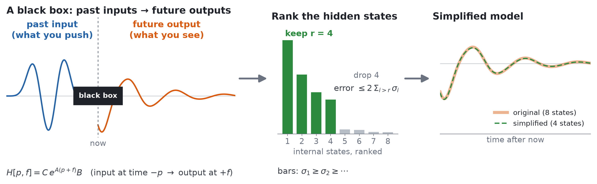
*Past inputs push a black box and its future outputs are measured; ranking its 8 internal states shows 4 matter, and the 4-state simplified model gives practically the same output.*

**Dynamical systems: the Koopman operator.** Studies how things move: fluids, planets, weather.
The motion of points can be very nonlinear, but the way *measurements* of the system change over
time is always linear. **Koopman's trick** is to track the measurements instead of the points. The
table maps "now" to "later"; the important directions are the slow, persistent patterns (modes)
that outlast the noise. In fluid dynamics this is **dynamic mode decomposition**. **Takens' theorem**
says a single measurement recorded over a window of time is enough to reconstruct the state, which
is exactly how you build the table from one time series.

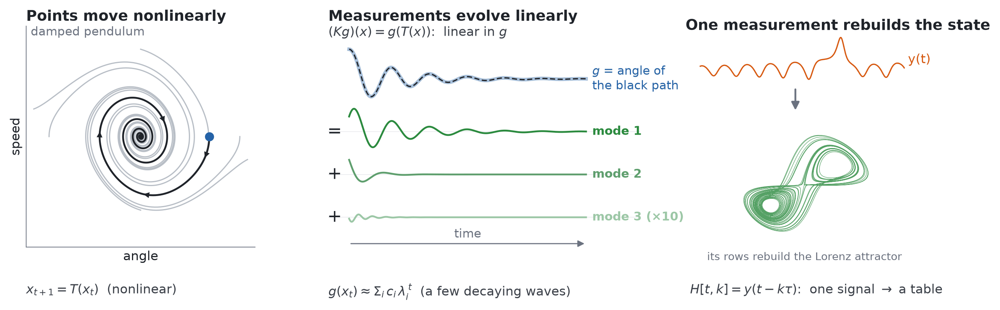
*A damped pendulum's points spiral nonlinearly, but a measurement of it (its angle) is a sum of a few decaying waves. And one measurement plotted against delayed copies of itself rebuilds the shape of the Lorenz attractor.*

**From a real paper (HAVOK).** Brunton et al. take one measurement x(t) of the chaotic Lorenz
system and stack it into a Hankel table H. The SVD of H gives a few coordinates in which the
butterfly attractor reappears and the dynamics are almost exactly **linear**. Almost: the last
direction doesn't fit, and acts like a rare, spiky outside "kick".

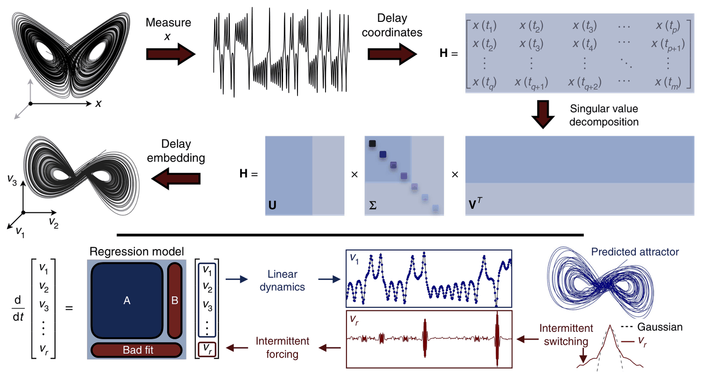

*Fig. 1 of Brunton, Brunton, Proctor, Kaiser & Kutz, ["Chaos as an intermittently forced linear system"](https://www.nature.com/articles/s41467-017-00030-8), Nature Communications 8, 19 (2017). © the authors, CC BY 4.0.*

The surprise is in that leftover direction, which you'd normally throw away as noise. Each time it
bursts (red), the trajectory is about to switch wings of the butterfly (blue ×). The "error term"
predicts exactly the rare events.

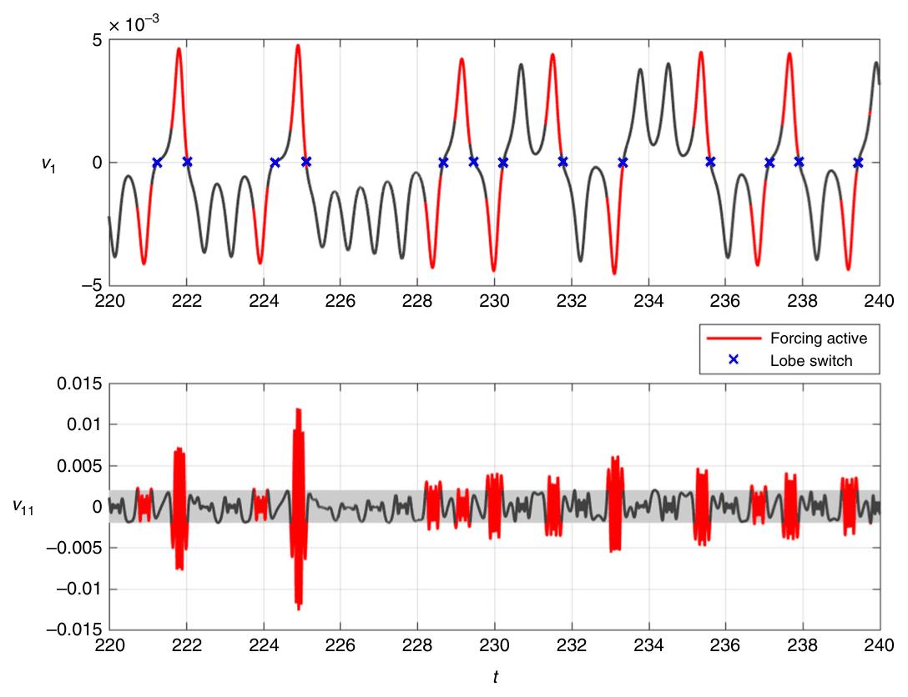

*Fig. 3 of Brunton et al. (2017), same source and license.*

**Probability: hidden Markov models.** Studies systems whose real state is hidden and seen only
through noisy signals. The table is the probability of each past followed by each future, and the
**hidden state** is the bottleneck in the middle: given it, past and future are independent. The
standard **forward and backward algorithms** are the two halves of the factorization.

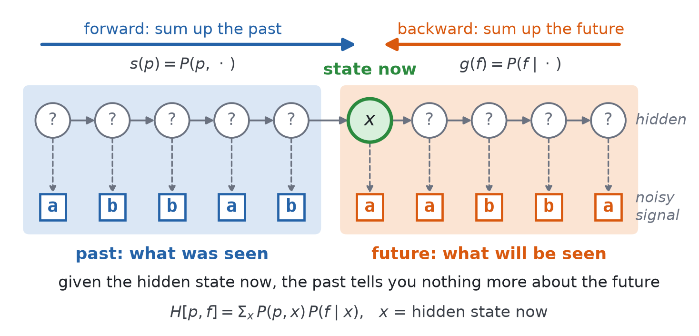
*The past and future of a noisy signal are linked only through the hidden state at "now": the forward algorithm summarises the past into it, the backward algorithm summarises the future.*

**Physics of complexity: causal states and ε-machines.** Studies how much memory a process really
has. Group pasts by the future they predict; the groups are **causal states**, and the resulting
minimal predictor is the **ε-machine**. This is Myhill–Nerode for random processes, and it gives a
principled measure of how complex a process is.

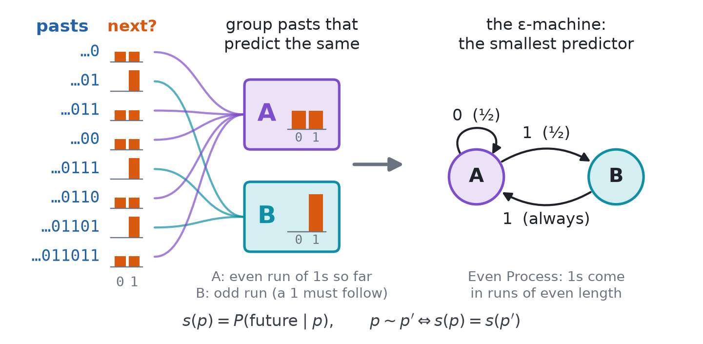
*In the Even Process (1s come in even-length runs), pasts sort into two groups by what they predict next, and those groups are the two states of the ε-machine.*

**Statistics: canonical correlation analysis (CCA).** Studies which aspects of one dataset
correlate most strongly with which aspects of another. Apply it to (past, future) and you get the
most predictive summaries of the past, ranked. For many processes this is exactly the SVD of the
table, with the right normalization.

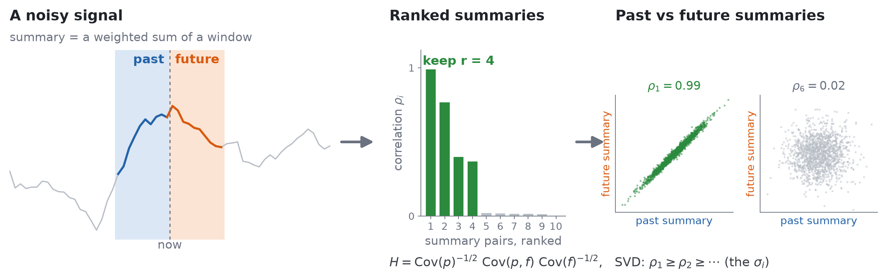
*Summarise a past window and a future window of a noisy signal: ranked by how well they predict each other, a few summary pairs matter and the rest are noise.*

**Graphs and data: spectral clustering.** Studies how to split a network or a dataset into natural
groups. Imagine a **random walker** on the data. Groups are places where it gets stuck for a long
time. The table is "where the walker is now → where it is a few steps later", and its top
directions mark the groups. Finding the best split is computationally hard; the **Cheeger
inequality** says this easy linear-algebra version is provably close. The same mathematics powers
**expander graphs** in theoretical computer science, and with them results like the logspace
algorithm for undirected connectivity and a combinatorial proof of the **PCP theorem**.

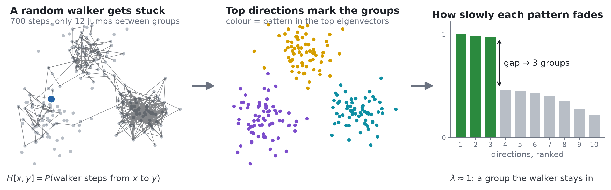
*A random walker on a point cloud rarely jumps between groups; the top eigenvectors of its step table colour the groups, and the gap after 3 eigenvalues says there are 3.*

**Moving data: coherent sets.** Studies regions that move together in a flowing system, like an
ocean eddy that carries the same water for months. The table maps where things are now to where
they are later. Its top directions find the regions that hold together while everything around
them mixes. This is spectral clustering with time added in, and it is the version I care most
about.

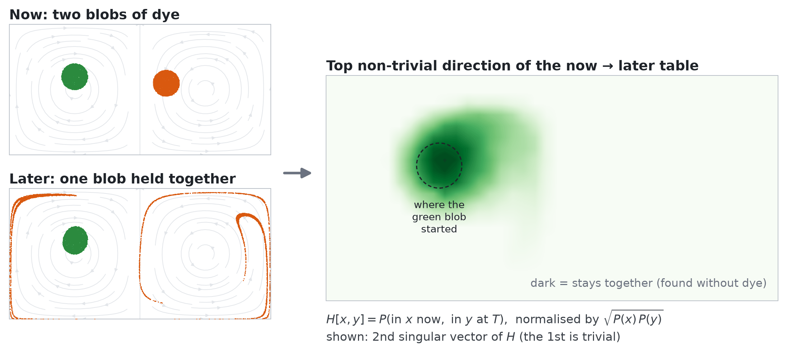
*In a rocking double-gyre flow, a dye blob in a whirlpool core holds together while one near the boundary smears out; the top non-trivial direction of the now → later table, computed without any dye, highlights that core.*

**Pure mathematics and physics: spectra and trace formulas.** A deep end, as a teaser. Quantum
mechanics can evolve either the states or the measurements (the **Schrödinger and Heisenberg
pictures**); those are exactly the "move the distributions" and "move the measurements" views
from the Koopman entry above. In geometry, the "sound" (spectrum)
of a surface encodes its closed loops, through **trace formulas**. **"Can you hear the shape of a drum?"** asks how much
of a shape its spectrum determines.

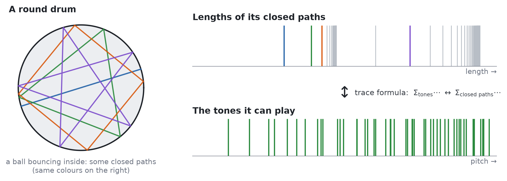
*Teaser: a round drum's closed bouncing paths are encoded in the tones it can play, a trace formula.*

**Brains and neural networks.** Simple learning rules for neurons (**Hebbian learning**) compute
related decompositions, such as principal components. A language model's predictions form exactly this table (beginnings of
text by continuations), and it turns out to be approximately **low-rank**. Transformers trained on
data from a hidden process have been found to represent the hidden state internally, the same
"state" as above.

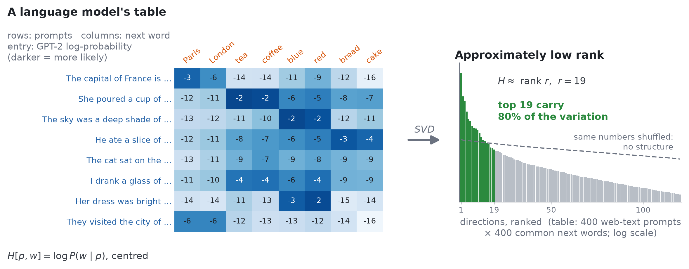
*Real GPT-2 log-probabilities, prompts by next words: 19 directions carry 80% of the variation, unlike the same numbers shuffled.*

**From a real paper.** Shai et al. train a small transformer on text from a 3-state hidden
process. The ideal state s(p) after a past p is a belief over the 3 hidden states, and those
beliefs form a fractal inside a triangle ("theoretical prediction"). A plain **linear** projection
of the transformer's activations draws the same fractal, and it gets sharper during training. The
network found the state of H[p, f] without ever being told it existed.

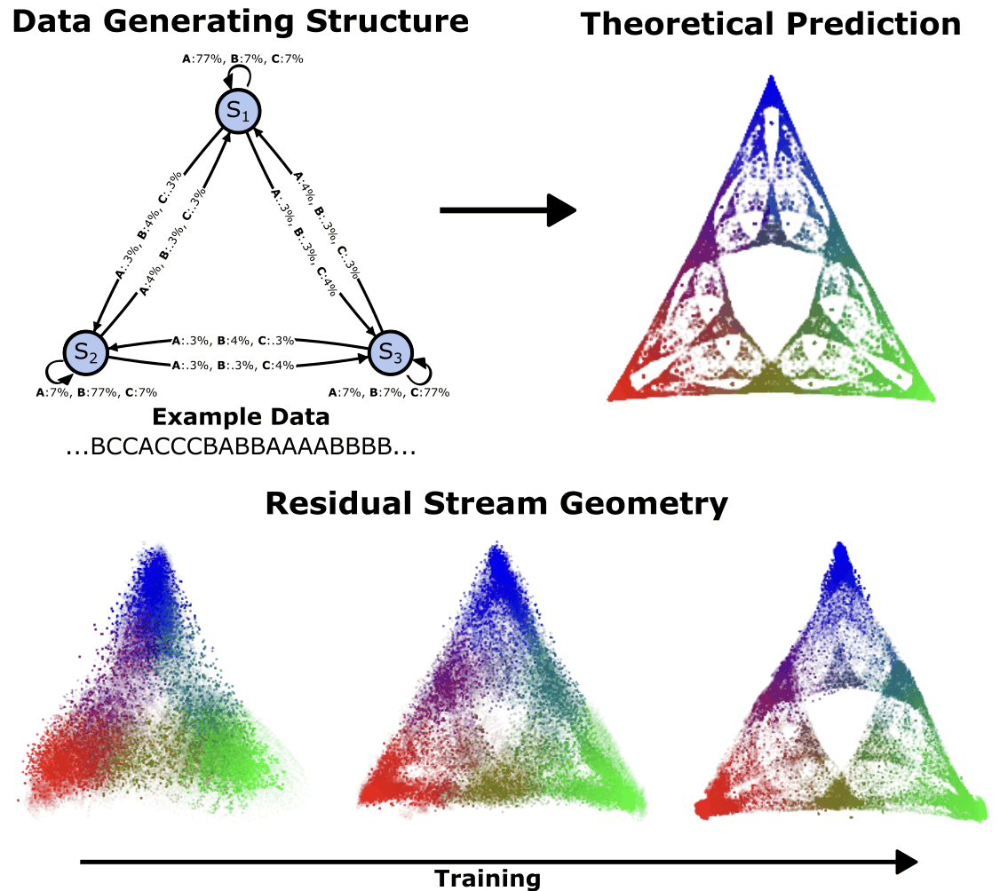

*Fig. 1 of Shai, Marzen, Teixeira, Gietelink Oldenziel & Riechers, ["Transformers represent belief state geometry in their residual stream"](https://arxiv.org/abs/2405.15943), NeurIPS 2024. Reproduced with attribution as an illustrative excerpt.*

---

## Why I think this is deep, natural and practical

**Deep.** The same construction is a theorem in automata theory, control, ergodic theory,
geometry, statistics and the theory of random processes, and it touches open problems in
decidability, the PCP theorem and quantum mechanics. When an idea is discovered
independently in this many places, it is usually tracking something real.

**Natural.** It answers the most basic modelling question, "what about the past matters for the
future?", in the most direct way: write down the past-to-future map and look at what it actually
uses. The only choices are what counts as past and future, how to weigh them, and how much detail to
keep.

**Practical.** It is linear algebra, so it runs fast on large data, comes with error bars, and has
none of the local optima of iterative training. It is used routinely in aerospace, circuit design,
fluid dynamics, protein-folding simulation, climate science, image segmentation and web search.

**The honest caveat.** The SVD gives the best summary *in the sense you chose*; choosing the table
and the weights is where the thinking happens. And a simplified table isn't always a valid smaller
machine of the original kind.

---

## Where I'm taking it

My research uses this to look inside neural networks: write down the right past-to-future table for
the network (from the outside, prompts to continuations; from the inside, activations at one layer to
the next), find its coherent sets, and keep track of exactly what is guaranteed and what isn't as you
zoom in. Notes so far (AI-assisted drafts):

- [Computational Mechanics and Epsilon-Machines](https://charlesr-w.github.io/crw-blog/Computational-Mechanics-and-Epsilon-Machines/)
- [Characterizing Predictive Salience via Hankel Spectra](https://charlesr-w.github.io/crw-blog/Characterizing-Predictive-Salience-via-Hankel-Spectra/)
- [The Spectral Structure of Natural Data](https://charlesr-w.github.io/crw-blog/The-Spectral-Structure-of-Natural-Data/)
- [A Spectral Theory of Computation](https://charlesr-w.github.io/crw-blog/A-Spectral-Theory-of-Computation/)
- [Mori–Zwanzig, Hankel Geometry and Context-Free Memory](https://charlesr-w.github.io/crw-blog/Mori-Zwanzig-Hankel-Geometry-and-Context-Free-Memory/)
- [Dynamic Spectral Geometry for Identifying Computations](https://charlesr-w.github.io/crw-blog/Dynamic-Spectral-Geometry-for-Identifying-Computations/)
- [Hankel HMM reconstruction widget](https://charlesr-w.github.io/crw-blog/Hankel-HMM-Reconstruction-Widget/) (interactive)

---

## What's in this repo

| File | What it is |
|---|---|
| [`SYLLABUS.md`](SYLLABUS.md) | A course outline to hand to an AI tutor: big ideas, in order, with what to ask about. |
| [`docs/field-guide.md`](docs/field-guide.md) | The detailed version of this page: precise statements, names and references. |
| [`spec/`](spec/) | Plans for an interactive tutorial site on this material (work in progress, written for interpretability researchers). |
